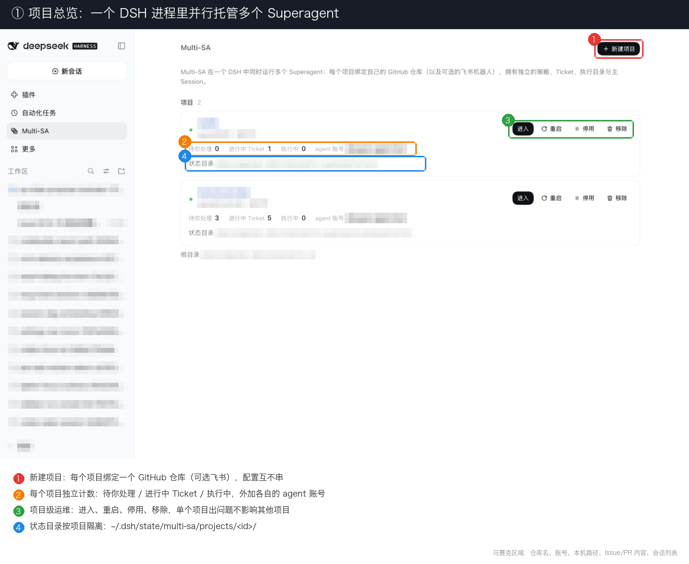
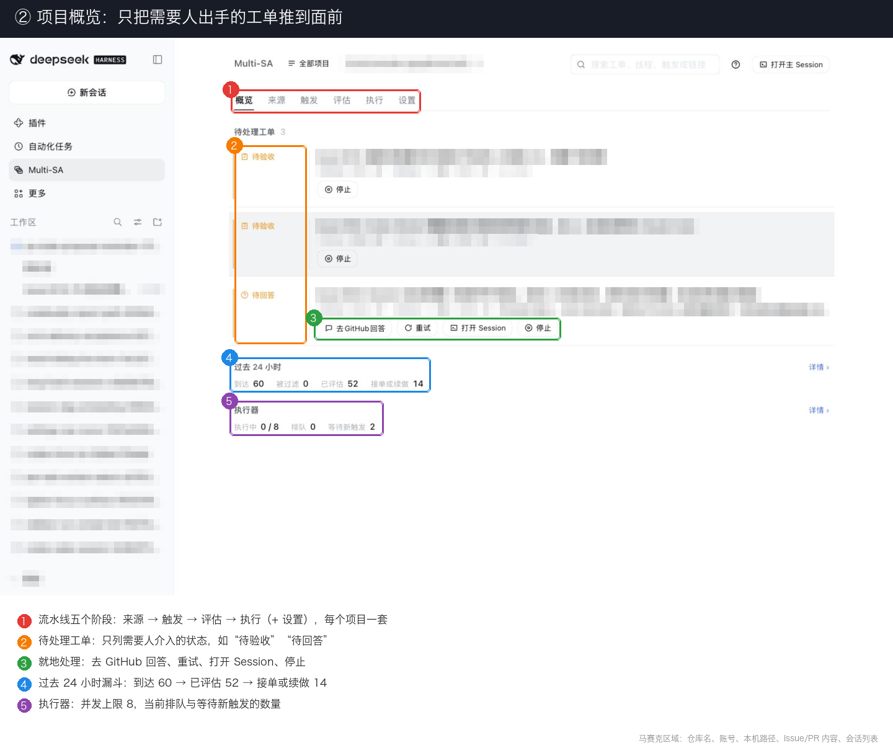
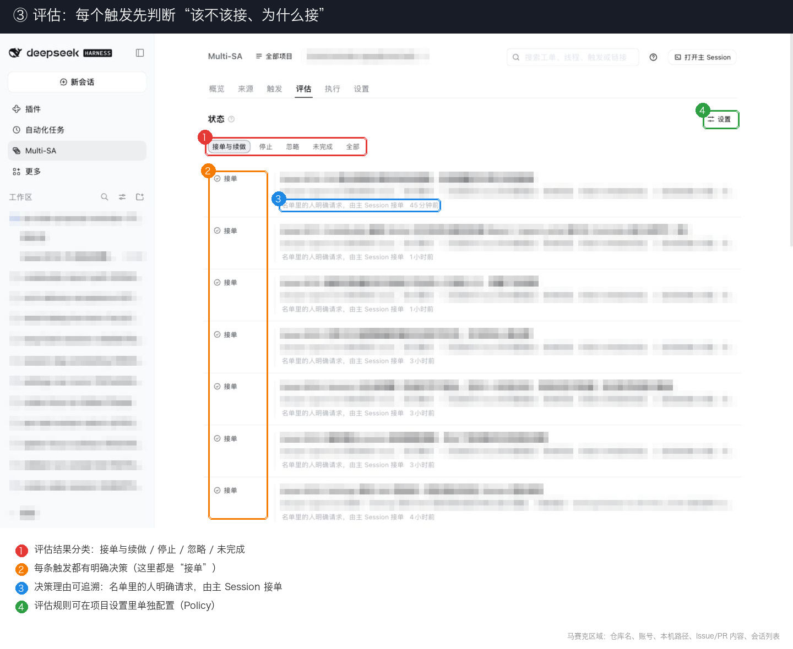
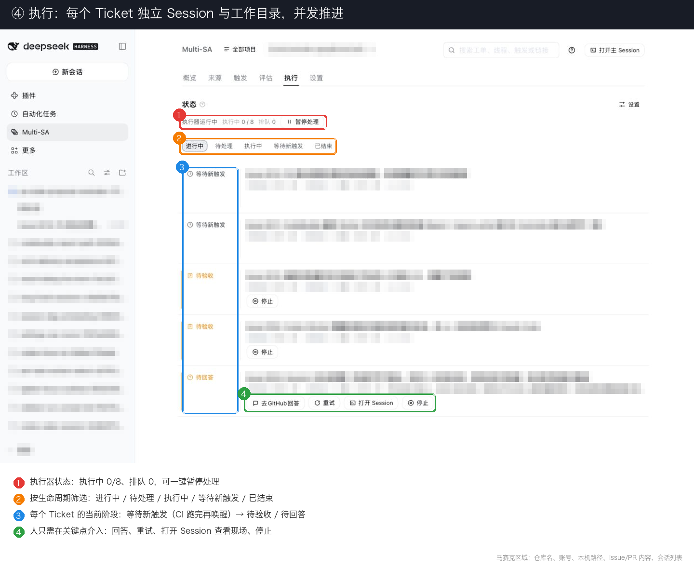

# Multi-SA · dsh-multi-superagent

[中文](README.md) · [English](README.en.md)

> **Research prototype for reference only, not an official DeepSeek product.** This repository is a **derivative / secondary development** of the public [dsh-superagent-prototype](https://github.com/deepseek-ai/dsh-superagent-prototype) (single-repo Superagent), extended for multi-project isolated parallel work. It is not affiliated with or endorsed by DeepSeek. The code grew out of our team's day-to-day development work, with much of the engineering done by coding agents. Treat it as research code, not production-ready software. It may still contain bugs, and its coding style and engineering practices may be inconsistent. Review and adapt it before using it in your own environment.
>
> We have adapted it for publication, so it is not identical to our internal version or the implementation described in *Exploring Super-agent Design: Towards a More Autonomous Agent System*. Some designs discussed in the article are directions for future development and are not implemented in this prototype. Treat the upstream repo as the source of truth for single-repo Superagent behavior; multi-project orchestration and isolation semantics here are maintained by this project.

## Overview

https://github.com/user-attachments/assets/1985790b-e8bb-4457-878e-0070fb652f6a

Architecture explainer for Multi-SA: multi-project, strongly isolated, parallel Superagent on DeepSeek Harness (research prototype).

## Why Multi-SA

The official / single-repo [dsh-superagent-prototype](https://github.com/deepseek-ai/dsh-superagent-prototype) is built for **one** GitHub repository: one Sources setup, one Policy, one execution context. Day-to-day work often spans several repos at once (paper, product, experiments…). Spinning up a full Superagent per repo is heavy to operate and easy to misconfigure across instances.

**Multi-SA** (`dsh-multi-superagent`) hosts **many projects** in one [DeepSeek Harness](https://www.deepseek.com/en/harness/) process, with isolation so they can run in parallel:

- **One project, one repository** — its own GitHub (optional Feishu), allowlists, and rules
- **One project, one state tree** — under `~/.dsh/state/multi-sa/projects/<id>/`; panel and APIs stay per project
- **One Ticket, one Session / work directory** — concurrent jobs do not share checkouts or sessions
- **One ops surface** — standalone profile `multi-sa`, port `3084`, and `scripts/dsh-superagent` for start / status / stop

It keeps the Superagent working style: **take as little human attention as possible, and give as much value as possible.** Act only when asked or when a team-written rule allows it; speak only when someone must act or can use a result. See [docs/000-philosophy.md](docs/000-philosophy.md).

## Compared with official single-repo Superagent

| | Official / single-repo `dsh-superagent` | Multi-SA (this repo) |
|---|---|---|
| Repos served at once | **1** | **Many**, in parallel |
| Config & auth | One global set | **Isolated per project** (Sources / Policy / Execution) |
| Ticket execution | Single-repo Session / worktree | **Separate Session and work directory per Ticket** |
| Panel | Single-repo view | **Per-project switching**, queues stay separate |
| DSH profile | `superagent` (often port `3082`) | **Standalone** `multi-sa` (`127.0.0.1:3084`) |
| State dir | `~/.dsh/state/superagent` | `~/.dsh/state/multi-sa` |
| Control script | that repo's script | this repo's `scripts/dsh-superagent` (defaults to 3084) |

**Do not** load `dsh-superagent` and `dsh-multi-superagent` in the same profile: each changes process-wide `PATH` / git settings and needs its own restarts. See the independent-profile section in [docs/006-deployment.md](docs/006-deployment.md).

## Panel tour

Screenshots of the local panel (`127.0.0.1:3084`). Project names, repositories, accounts, paths, and Issue / PR text are pixelated. Numbered color boxes mark the key parts (labels are in Chinese).

<table>
  <tr>
    <td width="50%" valign="top">
      <a href="docs/assets/panel/01-projects.png"></a>
      <p><b>① Projects</b>: one DSH process hosts many projects. Each project has its own counters, agent account, and state directory. You can open, restart, disable, or remove each one separately.</p>
    </td>
    <td width="50%" valign="top">
      <a href="docs/assets/panel/02-overview.png"></a>
      <p><b>② Overview</b>: tabs follow the flow: Sources → Triggers → Evaluation → Execution. Tickets that need a human can be handled in place. A 24-hour funnel shows arrived, evaluated, and accepted counts, plus executor concurrency.</p>
    </td>
  </tr>
  <tr>
    <td width="50%" valign="top">
      <a href="docs/assets/panel/03-evaluate.png"></a>
      <p><b>③ Evaluation</b>: each trigger gets exactly one decision, with a traceable reason (for example, "an allowlisted person asked explicitly; the main Session accepted"). Rules live in Policy.</p>
    </td>
    <td width="50%" valign="top">
      <a href="docs/assets/panel/04-execute.png"></a>
      <p><b>④ Execution</b>: each Ticket has its own Session and work directory. See executor status, filter by lifecycle, and follow each Ticket's stage (for example, waiting for a new trigger after CI, then waking) and human intervention points.</p>
    </td>
  </tr>
</table>

## Quick start

When DSH, a model provider, and this checkout are ready:

```sh
# First time only: create the profile and link this checkout
dsh multi-sa --from-default-profile web --dump-config > /dev/null
dsh plugin --profile multi-sa add "link:$PWD"
# Then set webserver (3084), stateDir, and models in
# ~/.dsh/profiles/multi-sa/cordis.patch.yml

cd /path/to/multi-sa
scripts/dsh-superagent start
scripts/dsh-superagent status
```

Open the `dsh web: http://127.0.0.1:3084/?token=…` URL from the latest start log. Create one project per repository in the panel, then configure Sources / Policy / Execution for each.

For a guided install (accounts, Sources, Policy), ask your coding agent to read [SETUP.md](SETUP.md) and walk through it with you.

## Documentation

Read the numbered docs in order; each builds only on earlier ones.

1. [000 Philosophy](docs/000-philosophy.md)
2. [001 Domain model](docs/001-domain.md)
3. [002 Authorization](docs/002-authorization.md)
4. [003 Execution](docs/003-execution.md)
5. [004 Prompts](docs/004-prompts.md)
6. [005 Panel](docs/005-panel.md)
7. [006 Deployment](docs/006-deployment.md) — install, config, upgrades, troubleshooting (incl. Multi-SA profile)
8. [007 Architecture](docs/007-architecture.md)
9. [008 Cookbook](docs/008-cookbook.md) — adding a Source

## Development

```sh
pnpm check   # typecheck, tests, and build
```

Pushing a `v*` tag runs GitHub Actions: `pnpm check`, pack a `.tgz`, and create a [Release](https://github.com/pprp/multi-superagent/releases).

## License

[MIT](LICENSE)
