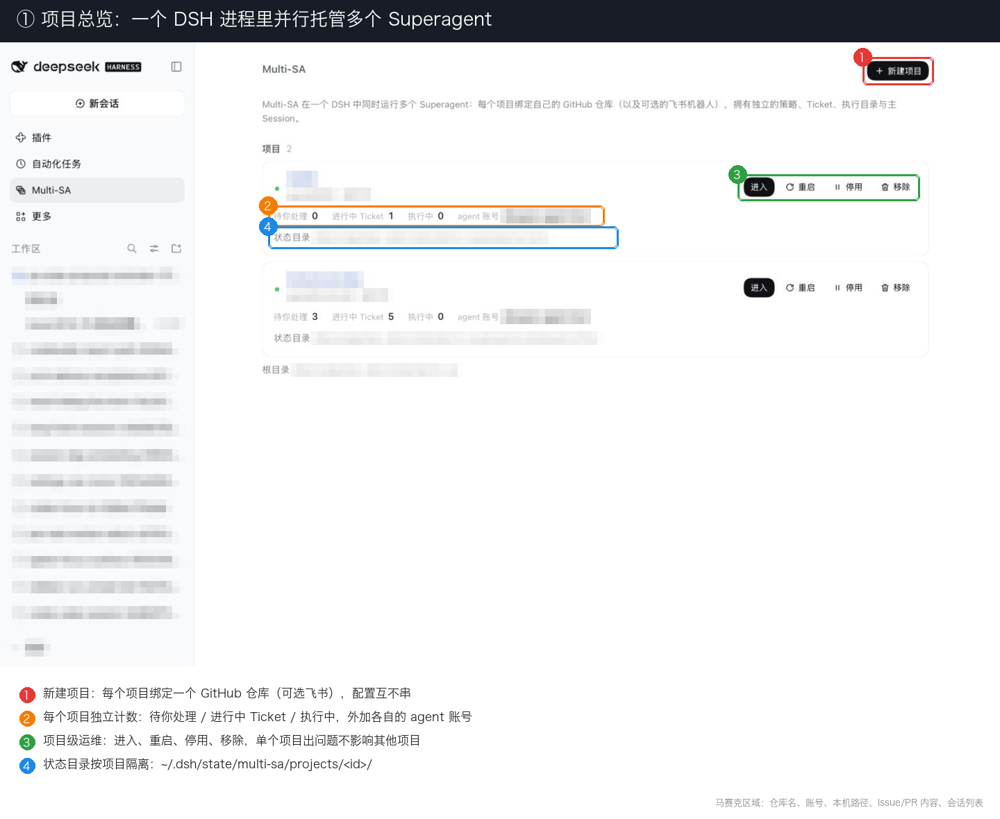
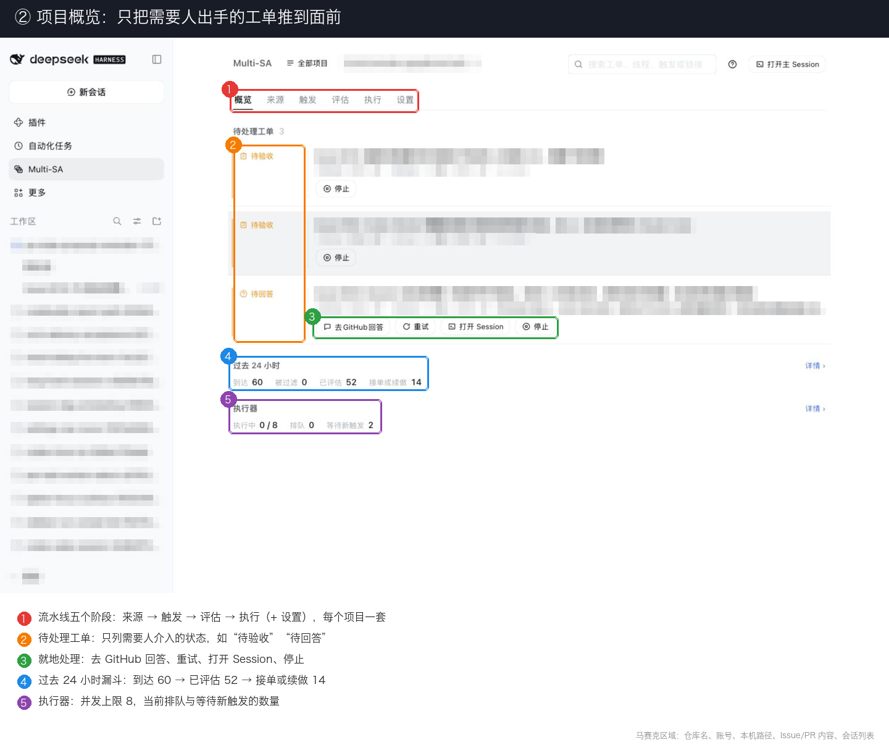
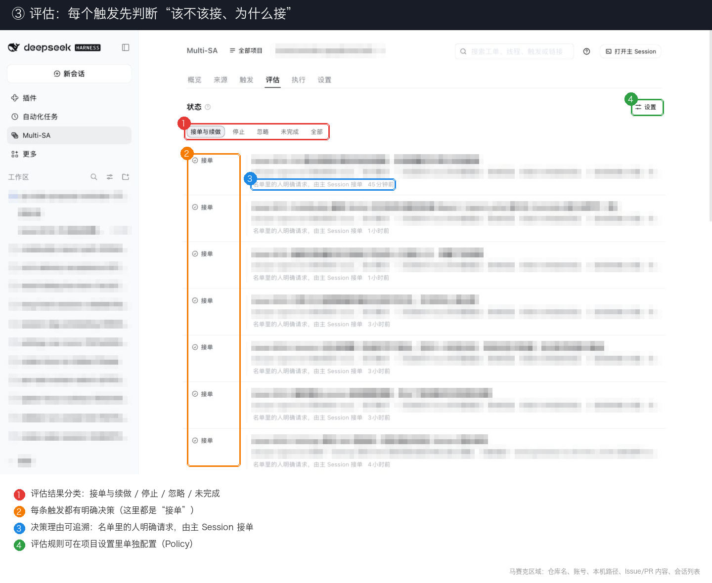
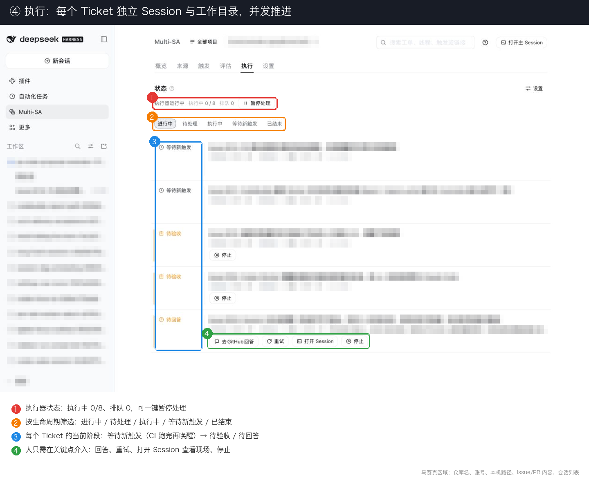

# Multi-SA · dsh-multi-superagent

[中文](README.md) · [English](README.en.md)

> **仅供研究参考的原型，非 DeepSeek 官方产品。** 本仓库是在官方公开的 [dsh-superagent-prototype](https://github.com/deepseek-ai/dsh-superagent-prototype)（单仓 Superagent）之上做的**二次开发 / 衍生实现**，用于多项目隔离并行；与官方仓库无隶属或背书关系。代码来自团队日常开发，大量工程由 coding agent 完成。请当作研究代码，不要当成生产级软件；可能仍有缺陷，风格与工程实践也不统一。接入自己的环境前请先审阅并改写。
>
> 为公开做了适配，与内部版本及文章 *Exploring Super-agent Design: Towards a More Autonomous Agent System* 中的实现并不完全一致。文中部分设计属于后续方向，本原型尚未实现。上游单仓能力与缺陷请以官方仓库为准；本仓新增的多项目编排与隔离语义由本项目自行维护。

## 架构一览

<video src="docs/assets/multi-sa-demo.mp4" controls width="100%"></video>

[multi-sa-demo.mp4](docs/assets/multi-sa-demo.mp4)

架构解说：Multi-SA 是 DeepSeek Harness 上的多项目、强隔离、可并行 Superagent（研究原型）。

## 为什么做 Multi-SA

官方 / 单仓 [dsh-superagent-prototype](https://github.com/deepseek-ai/dsh-superagent-prototype) 面向**一个** GitHub 仓库：一套 Sources、一套 Policy、一套执行上下文。实际工作里往往要同时推多个仓库（论文仓、产品仓、实验仓……）；若为每个仓各起一整套 Superagent，运维成本高，也容易串配置。

**Multi-SA**（包名 `dsh-multi-superagent`）在同一套 [DeepSeek Harness](https://www.deepseek.com/en/harness/) 进程里托管**多个项目**，并保证彼此隔离、可并行：

- **一项目一仓库**：各自的 GitHub（可选飞书）、允许名单与规则
- **一项目一状态**：`~/.dsh/state/multi-sa/projects/<id>/`，面板与 API 按项目隔离
- **一 Ticket 一 Session / 工作目录**：并发执行时不共用 checkout，不串会话
- **统一运维入口**：一个独立 profile `multi-sa`、一口 `3084`、一套 `scripts/dsh-superagent` 管控启停与健康检查

它仍遵循 Superagent 的用法：**尽量少占人的注意力，尽量多交付有用结果。** 只在有人点名、或团队写好的规则允许时行动；只在必须有人出手、或结果值得看时说话。原则见 [docs/000-philosophy.md](docs/000-philosophy.md)。

## 和官方单仓 Superagent 比什么

| | 官方 / 单仓 `dsh-superagent` | Multi-SA（本仓） |
|---|---|---|
| 同时服务的仓库 | **1 个** | **多个**，可并行 |
| 配置与鉴权 | 全局一套 | **按项目隔离**（Sources / Policy / Execution） |
| Ticket 执行 | 单仓 Session / 工作树 | **每 Ticket 独立 Session 与工作目录** |
| 面板 | 单仓视图 | **按项目切换**，待办互不混排 |
| DSH profile | `superagent`（常见口 `3082`） | **独立** `multi-sa`（`127.0.0.1:3084`） |
| 状态目录 | `~/.dsh/state/superagent` | `~/.dsh/state/multi-sa` |
| 控制脚本 | 单仓仓内脚本 | 本仓 `scripts/dsh-superagent`（默认口 3084） |

**不要**把 `dsh-superagent` 与 `dsh-multi-superagent` 装进同一个 profile：两者都会改进程级 `PATH` / git 设置，需要独立重启。部署细节见 [docs/006-deployment.md](docs/006-deployment.md) 的「独立 profile 部署」。

## 面板一览

下面是本地面板（`127.0.0.1:3084`）的截图。项目名、仓库、账号、路径和 Issue / PR 内容已打码；彩色编号框标出重点。

<table>
  <tr>
    <td width="50%" valign="top">
      <a href="docs/assets/panel/01-projects.png"></a>
      <p><b>① 项目列表</b>：一个 DSH 进程托管多个项目。每个项目有独立的计数、Agent 账号和状态目录，可单独进入、重启、停用或移除。</p>
    </td>
    <td width="50%" valign="top">
      <a href="docs/assets/panel/02-overview.png"></a>
      <p><b>② 项目概览</b>：标签按处理顺序排列：来源 → 触发 → 评估 → 执行。待人确认的 Ticket 可就地处理；24 小时漏斗显示到达、评估、接受的数量，以及执行器并发。</p>
    </td>
  </tr>
  <tr>
    <td width="50%" valign="top">
      <a href="docs/assets/panel/03-evaluate.png"></a>
      <p><b>③ 评估</b>：每条触发只得到一个决定，原因可追溯（例如「名单内的人明确请求，主 Session 接受」）。处理规则在 Policy 中配置。</p>
    </td>
    <td width="50%" valign="top">
      <a href="docs/assets/panel/04-execute.png"></a>
      <p><b>④ 执行</b>：每个 Ticket 有独立的 Session 与工作目录。可查看执行器状态、按生命周期筛选，并看到 Ticket 的阶段（如 CI 后等待新触发再唤醒）和人工介入点。</p>
    </td>
  </tr>
</table>

## 快速开始

本地已有 DSH、模型与本仓检出时：

```sh
# 仅首次：建独立 profile 并挂上本仓
dsh multi-sa --from-default-profile web --dump-config > /dev/null
dsh plugin --profile multi-sa add "link:$PWD"
# 再在 ~/.dsh/profiles/multi-sa/cordis.patch.yml 配 webserver(3084)、stateDir、模型

cd /path/to/multi-sa
scripts/dsh-superagent start
scripts/dsh-superagent status
```

面板链接在最新启动日志里的 `dsh web: http://127.0.0.1:3084/?token=…`。在面板里为每个仓库新建项目，再分别配 Sources / Policy / Execution。

一步一步装（含账号、Sources、Policy）：让 coding agent 读 [SETUP.md](SETUP.md)，按里面的问答与你一起做。

## 文档

按编号顺序读；后文只依赖前文。

1. [000 哲学](docs/000-philosophy.md)
2. [001 领域模型](docs/001-domain.md)
3. [002 鉴权](docs/002-authorization.md)
4. [003 执行](docs/003-execution.md)
5. [004 提示词](docs/004-prompts.md)
6. [005 面板](docs/005-panel.md)
7. [006 部署](docs/006-deployment.md) — 安装、配置、升级、排障（含 Multi-SA 独立 profile）
8. [007 架构](docs/007-architecture.md)
9. [008 Cookbook](docs/008-cookbook.md) — 加 Source

## 开发

```sh
pnpm check   # 类型检查 + 测试 + 构建
```

推送 `v*` tag 会触发 GitHub Actions：跑 `pnpm check`、打包 `.tgz` 并创建 [Release](https://github.com/pprp/multi-superagent/releases)。

## 许可

[MIT](LICENSE)
